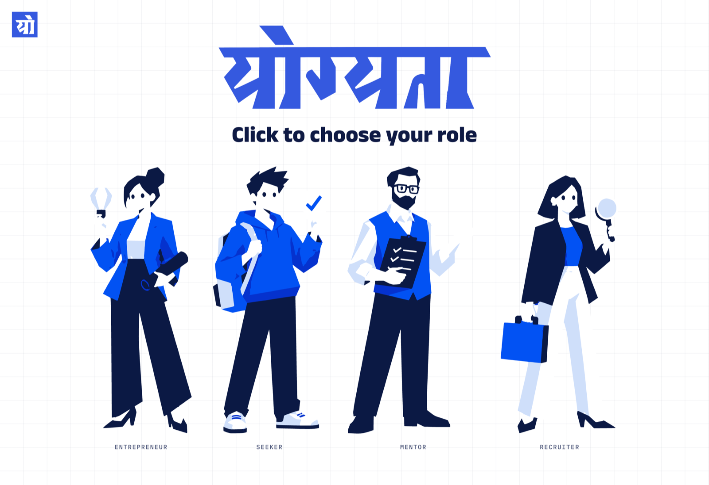
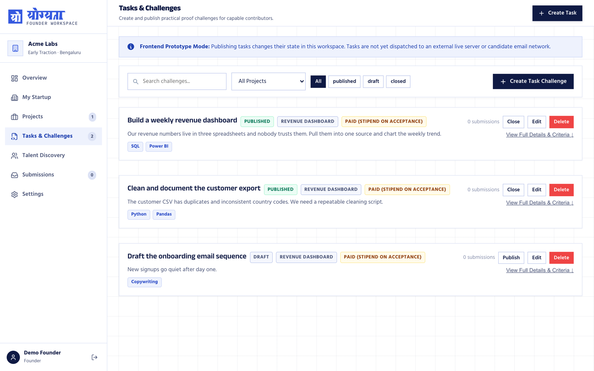
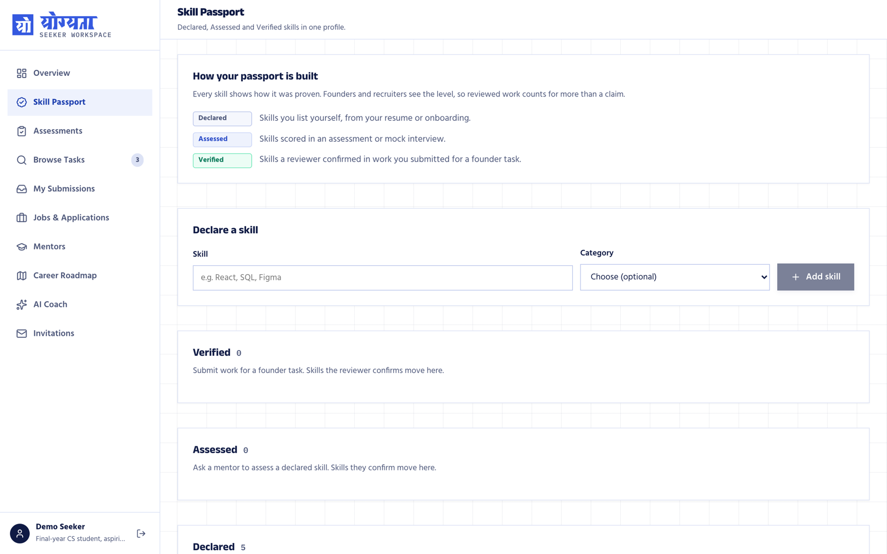
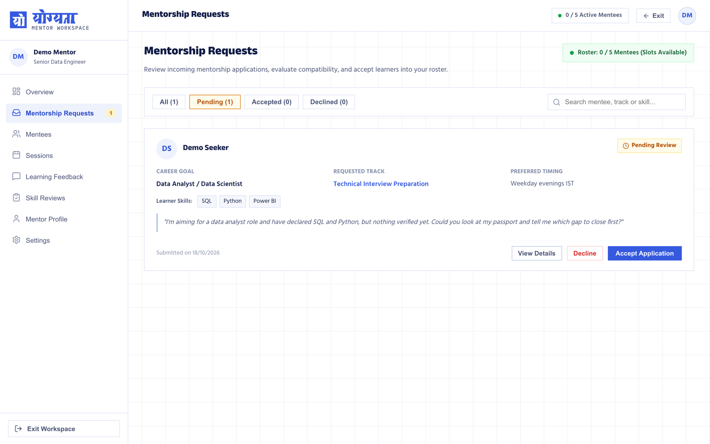
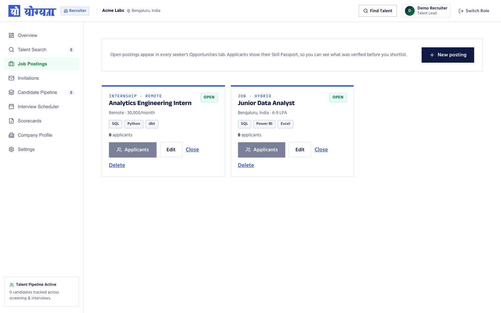
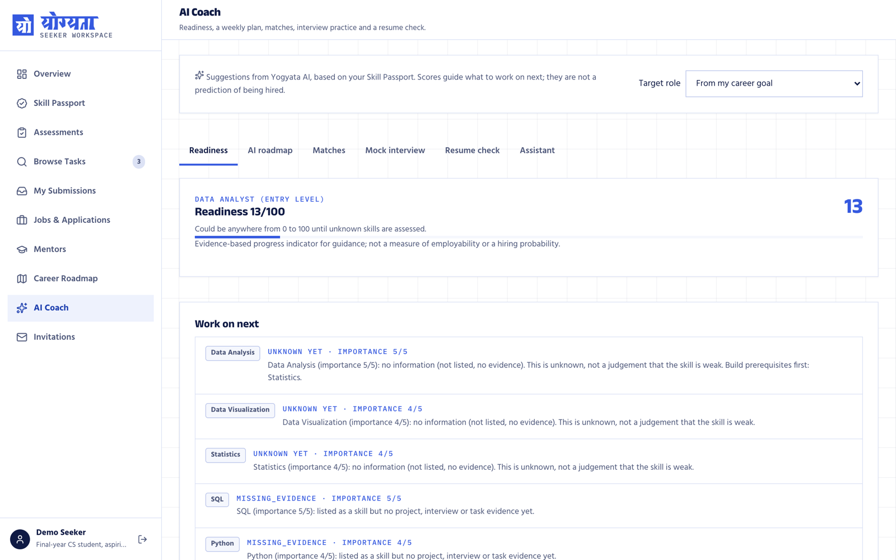
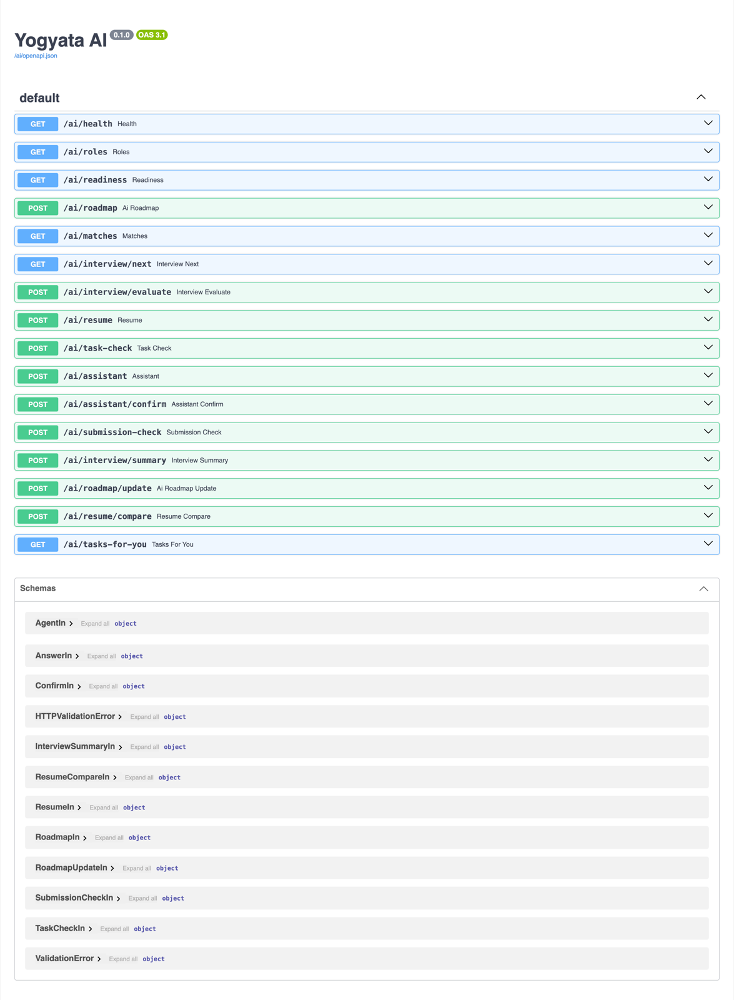

# Yogyata (योग्यता)

**A skills marketplace where students prove what they can do.** Instead of a CV full of claims,
every student builds a **Skill Passport** where each skill carries a level — *Declared*, *Assessed*
or *Verified* — and `Verified` can only be granted by a human who reviewed real work.

<p align="center">
  
</p>

## The four roles

One Supabase backend, four workspaces:

| Role | What they do |
|---|---|
| **Entrepreneur** | Posts real startup tasks, reviews submissions, endorses a skill as *Verified* |
| **Seeker** | Builds the Skill Passport, takes server-graded assessments, solves founder tasks, applies to jobs, works with mentors, follows a roadmap |
| **Mentor** | Answers mentorship requests, runs sessions, gives feedback, assesses declared skills |
| **Recruiter** | Searches opted-in talent, publishes job postings, runs a pipeline, interviews and scorecards |

Each role signs in at its own door and lands in its own workspace; typing another role's URL just
returns you to yours.

### The four portals

| **Entrepreneur** — post tasks, publish them, collect submissions | **Seeker** — the Skill Passport, and how each level is earned |
|---|---|
|  |  |
| **Mentor** — incoming requests, with the learner's goal and skills | **Recruiter** — postings that reach every seeker's Opportunities tab |
|  |  |

## The idea that holds it together

A skill is never "known" because someone says so. It climbs a ladder, and the top rung is not
self-service:

```
none  →  declared  →  assessed  →  verified
                                   ↑
                    only a founder endorsement or a mentor review,
                    through a Postgres function, under row-level security
```

This is enforced in the database, not in the browser. `endorse_submission_skill` and
`mentor_review_skill` are the only paths to *Verified*, and RLS decides who may call them — so a
second route to a verified skill (an API, a clever client, the AI service) would undermine the whole
passport. None exists.

## Run it

**Requires** Node 20+ and a Supabase project.

```bash
npm install
cp .env.example .env.local     # fill in VITE_SUPABASE_URL and VITE_SUPABASE_PUBLISHABLE_KEY
npm run dev                    # http://localhost:5173
```

The publishable key belongs in the browser — row-level security, not the key, decides what each user
can see. `src/lib/supabase.ts` throws at startup if either value is missing.

| Command | Does |
|---|---|
| `npm run dev` | Vite dev server, proxies `/ai` to the AI bridge |
| `npm run build` | type-check (`tsc -b`) then production build |
| `npm run lint` | Oxlint |
| `npm run preview` | serve the production build |

### AI coach (optional)

`yogyata-ai/` is an independent Python package — resume analysis, skill-gap readiness, roadmap
planning, opportunity and mentor matching, mock interviews, task interpretation and a career
assistant. It is **deterministic, offline and needs no API key**; no model is trained and an LLM is
optional, only ever wrapping a rule-based fallback.

```bash
npm run ai:setup    # once — needs uv; creates yogyata-ai/.venv on Python 3.12
npm run ai          # http://localhost:8787 — API docs at /ai/docs
```

Seekers then get an **AI Coach** tab and founders get **Check with AI** on the task form. Without the
service the rest of the app works normally and those screens explain how to start it.

<p align="center">
  
</p>

The screen above is the model's honesty on display: a readiness score is shown with the range it
could really be in, a skill with no evidence reads `UNKNOWN YET` with "this is unknown, not a
judgement that the skill is weak", and a declared-but-unproven skill reads `MISSING_EVIDENCE`. The
whole surface is visible at `/ai/docs`:

<p align="center">
  
</p>

Two invariants hold the trust model together, and both are covered by tests:

- **The bridge never mints evidence.** The agent session is not a trust boundary: `profile`,
  `evidence` and `review_ledger` are re-derived from Supabase on every call, because each would
  otherwise let a caller grant themselves a *Verified* skill.
- **The bridge holds no service-role key.** Every read uses the caller's own access token, so it can
  never see more than that user could.

It also refuses to guess. A target role with no reviewed skill catalog returns `422
unsupported_role` instead of being scored against a different role, and passport skills outside the
46-skill taxonomy come back as `unmapped_skills` so the UI can say which skills the model cannot
see — a confidently wrong readiness score being worse than an honest refusal.

> The bridge currently exposes more endpoints than the UI consumes: `/ai/submission-check`,
> `/ai/interview/summary`, `/ai/roadmap/update`, `/ai/resume/compare` and `/ai/tasks-for-you` are
> implemented and tested but not yet wired into a screen.

## Tests

```bash
cd yogyata-ai
.venv/bin/pytest -q                                      # 591 tests: package + HTTP bridge
.venv/bin/pytest server/tests/test_api.py -q             # just the bridge
.venv/bin/pytest server/tests/test_api.py::test_name -q  # one test
```

`server/tests/` stubs Supabase, so nothing touches the network. There is no frontend test runner.

**Database rules are tested in Postgres**, where they live. `supabase/tests/role_rules_test.sql` and
`workspace_rules_test.sql` exercise row-level security, skill endorsement and talent search: paste
one into the Supabase SQL editor and run it. Each ends by deliberately raising an error starting with
`RESULT:` that lists `ok<n>`/`FAIL<n>` per check — the error rolls the transaction back, so no test
rows survive.

## How it fits together

```
src/
  pages/RoleHome.tsx     the dispatcher — reads profile.role from Supabase, never the URL
  lib/*Data.ts           the only place that talks to Supabase; privileged writes go through RPCs
  lib/aiClient.ts        typed client for the Python bridge, attaches the user's access token
  <role>-onboarding/     one multi-step wizard per role
  <role>-workspace/      one workspace per role, tabs/ per nav section
yogyata-ai/
  src/yogyata_ai/        the package: 9 modules, deterministic, no training
  server/app.py          the HTTP bridge — verifies the token, reads Supabase as the caller
  server/vocab.py        translates app role labels and free-text skills into the package taxonomy
supabase/tests/          rolled-back SQL tests for the database rules
```

The schema itself lives in the Supabase project, not in this repo — there are no migration files, so
`src/lib/database.types.ts` (generated) is the reference for table and column shapes.

Screenshots in `docs/screenshots/` were captured against a running instance, using throwaway demo
accounts and seeded demo records — no real user's data appears in them.

## AI assistance

Parts of this project were built with AI help, using Claude Code (Anthropic): the Yogyata restyle,
the Supabase schema, security rules and tests, authentication, the rebuild of the mentor, recruiter
and seeker workspaces on Supabase, and the integration of the `yogyata-ai` package (its service
wrapper, AI Coach tab and task check). Every change was reviewed and directed by the project owner.
